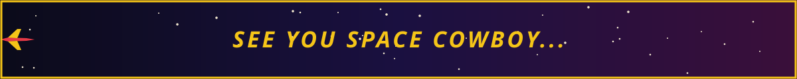

---

## 🚀 BOUNTY BOARD — misiones activas

| 🎯 Misión | 🛠️ Motor | 📡 Estado |
|---|---|---|
| **Chatarrero** | Unity |  |
| **Proyecto secreto** | Godot |  |
| **Modelado 3D** | Blender |  |
| **Animación** | Blender / Unity / Godot |  |

## 🧰 EQUIPO DE LA NAVE

## 📊 REPORTE DE VUELO

## 🐍 SNAKE ENTRE LAS ESTRELLAS

<picture>
  <source media="(prefers-color-scheme: dark)" srcset="https://raw.githubusercontent.com/SirFalconX/SirFalconX/output/github-contribution-grid-snake-dark.svg">
  
</picture>

